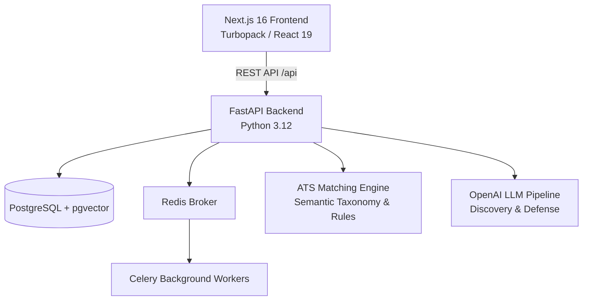

# CareerProof — Production ATS & Evidence-Based Resume Builder

> **CareerProof** is an evidence-first resume tailoring and industrial-strength ATS (Applicant Tracking System) matching platform. It bridges the gap between candidate qualifications and job descriptions through deterministic tenure analysis, semantic competencies extraction, objection defense, and verifiable proof ledgers.

---

## 🌟 Key Capabilities

### 1. Robust ATS Resume–Job Matching System
- **Intelligent Semantic Matching**: Resolves technical aliases and canonical synonyms (e.g., `k8s` $\rightarrow$ `kubernetes`, `postgres` $\rightarrow$ `postgresql`, `aws` $\rightarrow$ `amazon web services`, `golang` $\rightarrow$ `go`) without relying on simplistic keyword stuffing.
- **Evidence-Based Scoring Tiers**:
  - `strong` ($1.0\times$): Demonstrated in active production work experience with execution context.
  - `moderate` ($0.85\times$): Demonstrated in project bullets or profile summary.
  - `listed_only` ($0.60\times$): Merely present in a skills list without accomplishment evidence.
- **Deterministic Hard Eligibility Gating**:
  - Clean separation between **Overall Fit Score (0–100%)** and **Hard Eligibility Checks** (`passed`, `failed`, `unverifiable`).
  - Strict binary tenure gating: if a JD specifies a minimum YOE and candidate experience is below it, tenure is strictly evaluated without false inflation.
  - Checks minimum degree requirements and detects maximum tenure caps.
- **Multi-Dimensional Job Fit**:
  - Mandatory Skills vs Preferred Qualifications (prevents double-counting).
  - Core Responsibilities & Duties Coverage via action-verb stemming.
  - Education Level & Field of Study Alignment.
  - Domain / Industry Context (Fintech, Healthcare, Cloud Infrastructure, E-Commerce, B2B SaaS).
- **Dynamic Weight Re-Normalization**: Omitting optional JD fields (e.g., no degree stated or no preferred skills) automatically normalizes remaining active weights to 100% without score inflation or deflation.

### 2. Evidence-First Tailoring & Discovery
- **Multi-Resume Ingestion**: Ingests up to 3 versions of candidate resumes (PDF, DOCX, TXT) and structures them into an indexable evidence ledger.
- **Interactive Discovery Engine**: Identifies gaps, confirms ambiguities, and surfaces high-signal accomplishment questions before generating draft recommendations.
- **Claim Heatmap & Fact Verifier**: Ensures resume bullet points are grounded in verifiable facts and flags high-risk exaggerations.
- **Interview Defense & Objection Mitigation**: Generates talking points, proactively addresses resume red flags (tenure gaps, career transitions), and prepares personalized candidate defense notes.
- **High-Fidelity PDF & LaTeX Export**: Renders clean, single-page or two-page professional LaTeX templates.

---

## 🏗️ Architecture & Tech Stack



- **Frontend**: Next.js 16 (App Router, Turbopack), React 19, TypeScript, TailwindCSS, Framer Motion, Radix UI.
- **Backend**: FastAPI, Python 3.12, Pydantic v2, SQLAlchemy, Celery, Uvicorn.
- **Matching & Analytics**: Custom Semantic Taxonomy Engine, RegEx date parser, PyPDF/PDFMiner, NumPy.
- **Storage & Infrastructure**: PostgreSQL 18 with pgvector, Redis, Docker Compose.

---

## 🚀 Quick Start

### Prerequisites
- Node.js $\ge 20$ and npm
- Python $\ge 3.10$ (Anaconda or virtual environment)
- PostgreSQL (port 5432 or 5433) & Redis (port 6379)
- *(Optional)* OpenAI API Key for AI discovery and interview defense

### 1. One-Click Start (macOS / Linux)
The repository includes a launch script that verifies dependencies, starts Redis/Postgres, Celery workers, FastAPI, and Next.js:

```bash
chmod +x run.sh
./run.sh
```

### 2. Manual Startup

#### Backend Setup
```bash
cd backend
python3 -m venv venv
source venv/bin/activate
pip install -r requirements.txt

# Configure environment
cp .env.example .env # Set DATABASE_URL, REDIS_URL, OPENAI_API_KEY

# Start API Server
uvicorn app.main:app --host 0.0.0.0 --port 8000 --reload

# In another terminal, start Celery Worker
celery -A app.worker.tasks.celery_app worker --loglevel=info
```

#### Frontend Setup
```bash
cd frontend
npm install

# Start Next.js Development Server
npm run dev -- -p 3005
```

Once started:
- **Frontend Dashboard**: [http://localhost:3005](http://localhost:3005)
- **FastAPI Documentation**: [http://localhost:8000/docs](http://localhost:8000/docs)

---

## 🧪 Running Tests

### Backend Unit & Integration Tests (117+ Tests)
```bash
cd backend
PYTHONPATH=. pytest -v
```

Test coverage includes:
- `test_ats_matcher.py`: Semantic synonym matching, evidence levels, responsibility coverage, hard eligibility gates, and weight re-normalization.
- `test_tenure_matcher.py`: Precise date parsing, overlapping roles, ongoing jobs, and tenure boundaries.
- `test_rule_engine.py`: ATS scoring pipelines and backward-compatibility tests.
- `test_objection_engine.py` & `test_interview_defense.py`: Defense generation and claim verification.

### Frontend Typecheck & Build
```bash
cd frontend
npx tsc --noEmit
npm run build
```

---

## 📁 Repository Structure

```
resume_builder/
├── backend/
│   ├── app/
│   │   ├── api/             # FastAPI routes (ats, discovery, resumes, jobs)
│   │   ├── core/            # Configuration and database connectivity
│   │   ├── models/          # SQLAlchemy and Pydantic schemas
│   │   ├── services/
│   │   │   ├── ats_matcher.py       # Core semantic matching engine & taxonomy
│   │   │   ├── tenure_matcher.py    # Tenure calculator and eligibility gates
│   │   │   ├── rule_engine.py       # Rule integration & scoring pipeline
│   │   │   ├── interview_defense.py # Interview defense generation
│   │   │   └── fact_verifier.py     # Claim and fact checking
│   │   └── worker/          # Celery background tasks
│   └── tests/               # Pytest suite
├── frontend/
│   ├── src/
│   │   ├── app/             # Next.js App Router pages
│   │   ├── components/      # UI components (ATS checker, Workspace, Defense)
│   │   └── lib/             # API client, types, and utilities
│   └── tests/               # Playwright journeys & accessibility tests
├── docker-compose.yml       # Local PostgreSQL & Redis infrastructure
├── run.sh                   # Unified service manager
└── .gitignore               # Root ignore rules
```

---

## 📄 License

Proprietary and confidential. Built with ❤️ for CareerProof.
