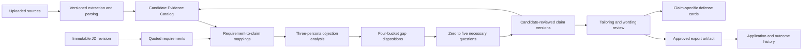

# CareerProof: target architecture

Proposed design, 2026-10-23. **Nothing in this document is implemented by this audit.** Current evidence and finding IDs: [CURRENT_STATE_AUDIT.md](CURRENT_STATE_AUDIT.md), [GAP_ANALYSIS.md](GAP_ANALYSIS.md).

## Architecture decision

Keep a modular FastAPI application, PostgreSQL/SQLAlchemy, Celery/Redis, and the existing Next.js light workspace. Introduce a normalized evidence domain alongside current tables, then migrate consumers incrementally. No graph database, multi-agent runtime, new vector database, or microservice split is required.

Reuse `DocumentExtractor`, `StructuredResumeParser`, `resume_parser.validate_resume_parse`, `candidate_profile.merge_profile`, `discovery.apply_answer/evidence_bullet`, `FactVerifier`, `TenureMatcher`, the existing LaTeX template and renderer, and working `LiveWorkspace` actions. Refactor rules into explainable evaluators instead of discarding them. Treat `SemanticMatchEngine` as retrieval assistance, never the source of factual truth.



Analysis may read extracted/unapproved facts to identify questions, but generation may only assert approved, current, supported claim versions. A failed or uncertain parse must not become an automatically approved fact.

## Domain invariants

1. Owner identity comes from verified authentication. Candidate identity is explicit and independent of account identity. Every resource lookup filters owner and candidate scope (F06/F09/F14).
2. Every substantive claim has a supporting source span or an explicit confirmation event attached to the **exact claim version**. A pasted note is a source, not automatic approval (F07/F08/F15).
3. Claims are atomic: one action, usage fact, responsibility, outcome, or qualification. An achievement can group several atoms; a rendered bullet can cite several atoms from the same engagement. Cross-engagement summary text must preserve each attribution (F17).
4. A metric belongs to an outcome claim and engagement; tool usage in one job cannot authorize it in another. Planned work remains planned until explicit new evidence confirms completion.
5. Source support, candidate approval, wording entailment and hiring relevance are separate axes. An LLM verdict cannot approve a candidate fact; a resume quote does not independently verify the real-world achievement (F10/F15).
6. A requirement being absent from the catalog means **unknown**, not proven inability. Bucket C “true deficit” requires candidate denial or sufficient explicit evidence, otherwise remains provisional pending clarification (F12).
7. A correction creates a new version; it invalidates dependent editable drafts and analyses. Submitted versions remain historical. Their original artifacts can still be downloaded with a stale-source notice (F18).
8. No export-time rewrite. Selection or wording changes, including one-page shortening, create another reviewed draft version before export (F16).
9. Model and parser failures have explicit statuses, do not fabricate success/verification, and never relax approval or attribution checks (F13/F25).

## Proposed relational model

Use UUID IDs for new domain entities; keep existing integer IDs in legacy mapping rows. Include created_at, actor identity and tenant ownership on roots. Prefer relational fields for identifiers/state/constraints and JSONB only for structured extraction payloads, rationale and immutable input snapshots. Define database uniqueness and CHECK constraints; application validation alone is insufficient.

| Proposed table | Essential fields / relationships | Purpose |
|---|---|---|
| `candidates` | id, user_id, display_name, status, catalog_revision | Explicit owner-scoped profile; multiple candidates per account without cross-contamination. |
| `candidate_source_assignments` | candidate_id, source_id, decision_actor, decision_at; unique(source_id) for active assignment | Identity-confirmed source assignment; ambiguous imported sources quarantined. |
| `source_documents` | id, user_id, media_type, filename, object_key nullable for legacy, sha256, extracted_text_sha256, status, retention_state | Immutable source identity; distinguish available original bytes from text-only legacy imports. No reconstructed bytes presented as original upload. |
| `parse_runs` | source_id, parser_version, model/prompt_version nullable, status, error_code, extraction_hash | Reparse is a new run, not destructive bullet replacement. |
| `source_spans` | id, parse_run_id, page nullable, block_id nullable, start/end offsets, bbox nullable, quote, quote_sha256 | Exact locators; validate offset/quote/hash against stored extraction. DOCX/TXT need not pretend to have PDF page numbers. |
| `engagements` | id, candidate_id, kind(job/project/education/volunteering), organization/project name, role, dates/location and their source refs | Stable attribution owner for achievements/metrics; conflicts are explicit rather than silent merges. |
| `achievements` | id, candidate_id, engagement_id, title, current_version | Groups related actions/results while atomic facts remain separately reviewable. |
| `claims` | id, candidate_id, engagement_id nullable for profile-level fact, achievement_id nullable, kind, current_version_id, lifecycle | Durable fact identity. kinds: action, usage, outcome, responsibility, credential, profile_fact. |
| `claim_versions` | id, claim_id, version, supersedes_version_id, text, structured_fact JSONB, temporal_status, depth, ownership_level, personal_contribution, team_outcome, created_by, reason | Immutable factual meaning; unique(claim_id,version). `temporal_status`: planned/in_progress/completed/unknown; depth includes tutorial/familiarity/team_only/project/professional/unknown. |
| `claim_support` | claim_version_id, source_span_id nullable, confirmation_id nullable, relation(supports/contradicts), asserted_fields JSONB | One and only one support target per row; multiple rows allowed. Enforce all targets belong to same tenant/candidate source assignment. |
| `claim_metrics` | id, claim_version_id, engagement_id, measure, baseline nullable, result nullable, unit, direction, population/window, methodology, measurement_status, source links | Preserve strings/Decimal, not imprecise floats; source-backed percentages can exist with baseline unknown, but cannot be called measurement-reviewed without method/support. |
| `artifacts` / `artifact_reviews` | candidate_id, URI/object_key, content hash, relationship to claim version, review status/reviewer/time | Artifact URL presence alone does not verify it; external fetching isolated and opt-in. |
| `claim_verifications` | claim_version_id, check_type, result, reasons, support IDs, verifier/model/prompt_version, checked_at | Literal grounding / semantic entailment / artifact review events. Results pass/fail/unknown/error. Never imply externally verified achievement from a parser result. |
| `confirmations` | candidate_id, question_id nullable, actor_id, exact statement, context, submitted_at | Explicit candidate statements, provenance for facts absent from resume. |
| `claim_approvals` | claim_version_id, actor_id, decision(approved/rejected/revoked), statement_hash, timestamp | Append-only approval events; current approval resolves from events. Superseded version approval does not carry forward. |
| `claim_conflicts` / `conflict_resolutions` | candidate_id, involved version IDs, type(metric/attribution/identity/time), state; selected versions/keep-separate decision, actor/time | Preserve `merge_profile` detection as a candidate generator, require review for uncertain merges. |
| `job_versions` / `job_requirements` | existing job_id, version, raw JD/hash; requirement_id, quote/offsets, kind, required/preferred/unknown, importance, threshold, alternatives | Immutable requirement interpretation; every requirement cites the JD, never company insight as a mandatory qualification. |
| `analysis_runs` / `requirement_matches` | candidate_id, catalog_revision, job_version_id, selected draft nullable, rules/model/prompt versions, status; requirement_id, claim_version_ids, coverage/uncertainty, rationale | Reproducible analysis identity; compare full catalog with selected resume without conflating them. |
| `objections` | analysis_run_id, persona, requirement_ids, claim_version_ids, cited contradictions/missing evidence, hypothesis, priority, basis | Distinguish rule suggestion from grounded reasoning. No uncalibrated probability field disguised as hiring certainty. |
| `gap_cases` / `gap_events` | analysis_run_id, requirement_id, bucket A/B/C/D, provisional boolean, state, disposition, linked objections/claims | Persist resolution workflow and reasons; unique active case per requirement+analysis where appropriate. |
| `discovery_questions` / `discovery_answers` | session/candidate/job version, gap_case_id, requirement quote, benefit, kind, expected claim version, ordinal; answer/skip/deny/confirm and attribution | Max five issued questions per analysis resolution cycle, including skips; fifth critical-only. Repeated topics fingerprinted, confirmed facts reused. |
| `resume_versions` / `resume_claims` | existing optimization_id, version, candidate/job version, profile snapshot, status/hash; rendered bullet, ordered claim_version links, selection rationale, included/pinned, review state/history | Version the output; multiple source atoms per bullet. Composite FK/scope checks prevent wrong-candidate support. |
| `export_artifacts` | resume_version_id, approved_content_hash, template_version/hash, PDF/DOCX bytes object_key/hash, page_count, readability_result, created_at | Exact reproducible output. Submitted exports immutable; template/font changes generate a new artifact. |
| `defense_cards` / `defense_attempts` | resume_version_id, rendered claim ID, source versions, probes; explanation/feedback, timestamp | Practice exact wording with persisted answers; factual additions become unapproved proposals. |
| `application_events` | existing tracker_id, resume_version_id/export_artifact_id, event/status/time | Historical outcomes and exact submitted version, separate from mutable current draft. |
| `processing_jobs` / `outbox_events` | idempotency key, input revision/hash, status, lease/heartbeat/retries/error; event payload/published_at | Durable async state and crash recovery (F23). |
| `legacy_entity_map` | entity_type, legacy_id, new_id, migration_run | Idempotent backfill and traceable compatibility adapters. |

Suggested indexes: `(user_id,candidate_id)` scoped roots; `(candidate_id,lifecycle)` claims; unique `(claim_id,version)`; `(claim_version_id)` support/approval/draft links; `(requirement_id,analysis_run_id)` mappings; `(status,lease_expires_at)` jobs; unique idempotency keys scoped owner+operation. Composite tenant/candidate constraints must prevent cross-owner links even if an application query is wrong.

### Example claim aggregate (proposed API representation)

Illustrative schema, not a stored candidate or assertion of existing data:

```json
{
  "id": "claim_uuid",
  "candidate_id": "candidate_uuid",
  "version": 2,
  "engagement_id": "ingestion_project_uuid",
  "achievement_id": "pipeline_achievement_uuid",
  "kind": "outcome",
  "text": "Reduced ingestion runtime by 40%.",
  "temporal_status": "completed",
  "depth": "professional",
  "ownership": {
    "level": "contributor",
    "personal_contribution": "Implemented batch writes",
    "team_outcome": "Reduced ingestion runtime by 40%"
  },
  "metrics": [{
    "measure": "ingestion runtime",
    "reported_change": "40",
    "unit": "percent",
    "baseline": null,
    "methodology": null,
    "measurement_status": "reported_unvalidated",
    "support_ids": ["support_uuid"]
  }],
  "support": [{
    "id": "support_uuid",
    "source_span_id": "span_uuid",
    "relation": "supports",
    "quote": "Reduced ingestion runtime by 40%.",
    "fields": ["text", "metrics.0.reported_change"]
  }],
  "verification": {"literal_grounding": "passed", "artifact_review": "unknown"},
  "approval": {"status": "pending", "version": 2},
  "conflicts": [],
  "eligible_for_generation": false
}
```

Ownership fields in this example require their own confirmation/support rows before approval. A source metric does not establish the candidate's individual contribution. Server validation must verify field-level coverage, not merely that the support array is nonempty.

## Analysis and gap policies

Retain `ObjectionEngine` rule patterns as transparent detectors, but feed typed requirements and scoped claim versions. Replace `len(experience)*1.5` with `TenureMatcher` on sourced dates. Use LLM reasoning only where it improves requirement interpretation, transferable-pattern explanation, and question wording; model output must cite IDs and quotations from provided inputs and pass typed validation. Record model/prompt version, input hashes, latency and token usage. No specific new model selection is required by this audit; evaluate the configured provider behind an interface before migrating models.

| Bucket | Definition and action | Completion condition |
|---|---|---|
| A: unexpressed | Relevant supported catalog fact absent/unclear in selected resume. Clarify only material missing ownership/outcome context. | User approves claim version and inclusion/wording, or deliberately omits it. |
| B: transferable | Adjacent demonstrated pattern; exact target technology not established. | User confirms actual work, approves honest adjacent framing. Never add target technology as used. |
| C: true deficit | Candidate confirms no relevant experience; unconfirmed absence remains provisional. | Defer/omit, or complete a proof task then ingest/review new evidence. A planned task is not work experience. |
| D: hard constraint | Explicit mandatory eligibility requirement with sourced wording and alternatives. | User declaration/document confirms met/not met/unknown; no rewriting can resolve factual ineligibility. |

Gap states: `open → awaiting_clarification → proposal_ready → resolved`; alternatives `deferred`, `not_met`, `dismissed_with_reason`. Resolution references the actual confirmation, approved claim or user decision. Recompute analysis when a linked claim/JD version changes; retain old analysis for historical drafts.

Question selection: inspect all candidate sources and approved answers first; rank explicit important requirements by decision impact. Ask zero if sufficient evidence; ordinarily one or two, maximum five, fifth critical-only. Each question contains requirement quote, reason/benefit, linked gap and intended decision. Stop when answers would not change inclusion, factual wording or qualification status. Provider failure must not silently invoke generic work-history questions. Preserve current `llm_next_question` checks and strengthen them with typed identifiers/state.

## Proposed API contracts

Introduce `/api/v2` while keeping existing `/api` adapters during migration. All mutations require authenticated principal; candidate scope is server-validated. Response objects include `id`, `revision` where mutable, and trace/request_id. Pagination uses `cursor`, `limit <= 100`. Standard errors: `{error:{code,message,request_id,details}}`; 401 invalid identity, 404 wrong-scope/not found, 409 version/state conflict, 422 validation/unsupported claim, 503 provider/queue unavailable. Never return raw provider exceptions or secrets.

| Proposed endpoint | Request | Success / invariant |
|---|---|---|
| `POST /candidates` | display_name | 201 candidate with revision; no automatic email-based merge. |
| `POST /candidates/{id}/sources` | multipart files, Idempotency-Key | 202 `{source_ids, job_id, status:"queued"}`; same input key cannot duplicate ingestion. |
| `GET /processing-jobs/{id}` | — | stage/status/progress/retryable/error_code; poll active jobs only. |
| `GET /candidates/{id}/claims` | cursor, state, engagement, query | paginated current claim versions and evidence summary; no account-wide mixing. |
| `GET /sources/{id}/spans/{spanId}` | — | exact quote/location/availability; signed original-object access where retained. |
| `POST /claims/{id}/versions` | expected_version, factual changes, source/confirmation IDs, reason | 201 pending claim version, affected draft/analysis IDs; 409 stale edit. |
| `POST /claim-versions/{id}/approvals` | decision, statement_hash, expected_version | 201 immutable event; server validates current version, required field support and unresolved conflicts. |
| `POST /conflicts/{id}/resolutions` | expected_revision, chosen versions or keep-separate, reason | resolved conflict and new catalog_revision; no silent suppression of historical evidence. |
| `POST /jobs/{id}/versions` | raw_text, source context | 202 requirement extraction job; exact JD text/hash preserved. |
| `POST /analyses` | candidate_id, job_version_id, expected_catalog_revision, resume_version_id nullable | 202 analysis job; source snapshot fixed. |
| `GET /analyses/{id}` | — | requirements, coverage, three-persona objections, gap cases, provenance, generation_mode/status. |
| `POST /gap-cases/{id}/discovery` | expected_analysis_revision | next necessary question or `{question:null,reason:"sufficient_evidence"}`; server owns global cycle budget. |
| `POST /discovery-questions/{id}/answers` | expected_claim_version nullable, response kind, text, engagement/depth/ownership, confirmation bool | saved answer, proposed claim versions, refreshed gap status and next question; no auto-promotion of interpreted terms. |
| `POST /gap-cases/{id}/dispositions` | resolution type, reason, approved claim/version or proof_task_id | validated bucket-specific transition; task completion alone cannot approve a claim. |
| `POST /resume-versions` | candidate_id, job_version_id, analysis_id, approved_claim_version_ids, template_id | 202 draft proposal job; reject unapproved/stale/conflicted claims. |
| `PATCH /resume-versions/{id}/claims/{bulletId}` | If-Match revision, action accept/revert/edit/include/exclude/pin, proposed text | reviewed wording with source atoms, verifier checks and new revision. Edit that changes factual meaning creates claim proposal instead. |
| `POST /resume-versions/{id}/compact` | If-Match, target_pages:1 | derived draft + change/omission diff, pending review; never directly downloads changed wording. |
| `POST /resume-versions/{id}/exports` | approved content hash, template version, page policy | 202 render job or 409 page_limit with page count/options; no rewriting. Completion returns artifact metadata/download URL. |
| `POST /applications` | candidate_id, job_version_id, submitted_export_id nullable, status | persistent pipeline item with validated ownership; submission requires reviewed artifact. |
| `POST /applications/{id}/events` | expected_revision, status, occurred_at | append status history; GET reads current projection. |
| `GET /resume-versions/{id}/defense-cards`; `POST /defense-cards/{id}/attempts` | explanation on POST | questions tied to exact wording/source versions; saved feedback, potential correction proposals separate from catalog approval. |

Example state-sensitive answer response:

```json
{
  "answer_id": "answer_uuid",
  "persisted": true,
  "catalog_revision": 19,
  "proposed_claim_versions": ["claim_version_uuid"],
  "approval_required": true,
  "gap_case": {"id": "gap_uuid", "state": "proposal_ready"},
  "question_budget": {"issued": 2, "maximum": 5},
  "next_question": null
}
```

Immediate bridge work does **not** need v2: wire `/discovery/{id}/answers`, `/resolve`, `/evidence-drafts/{id}/review` and current revision checks into main Workspace first. New contracts formalize guarantees existing JSON endpoints cannot express, not a parallel replacement application.

## Frontend decomposition

Keep current CSS/primitives and progressively replace sections behind adapters. Existing `careerproof/objections.tsx::HiringObjectionView`, `defense.tsx::InterviewDefenseView`, `ats-checker.tsx::ATSCheckerModal`, `claim-heatmap.tsx::ClaimHeatmapView` are reusable views, not proof of durable state. Extract working logic from `LiveWorkspace.submitAnswer`, `reviewClaim`, `handleGeneratePdf`, conflict/correction controls.

```text
src/app/(workspace)/layout.tsx              shared shell / active candidate context
src/app/(workspace)/dashboard/page.tsx
src/app/(workspace)/evidence/page.tsx
src/app/(workspace)/jobs/[jobId]/page.tsx
src/app/(workspace)/analyses/[analysisId]/page.tsx
src/app/(workspace)/gaps/[gapId]/page.tsx
src/app/(workspace)/resumes/[versionId]/page.tsx
src/app/(workspace)/defense/[versionId]/page.tsx
src/app/(workspace)/applications/page.tsx
src/features/shell/                        Sidebar, Topbar, CommandPalette
src/features/ingestion/                    UploadDialog, ParseStatus, SourceReview
src/features/evidence/                     Catalog, ClaimDrawer, ConflictReview, ApprovalPanel
src/features/jobs/                         JDInput, RequirementsTable
src/features/objections/                   PersonaPanel, ObjectionCard, SourceRationale
src/features/gaps/                         BucketBoard, DiscoveryQuestion, ProofTask
src/features/resumes/                      Studio, BulletEditor, ChangeReview, PDFPreview, ExportDialog
src/features/defense/                      DefenseCard, AttemptForm, Feedback
src/features/applications/                 Kanban, ApplicationDrawer, OutcomeHistory
src/shared/api/                            generated DTOs, authenticated client, typed errors
src/shared/ui/                             existing Button/Modal/Badge adapters
src/shared/workflow/                       state transition selectors (not duplicate policy)
```

Each feature owns components, queries/mutations, adapters, and tests. Server data comes from one query/cache layer, keyed by candidate + job revision + draft version. Use a query library if desired; a small typed hook layer is also sufficient. UI-only state stays local (drawer, filter, unsaved text). URL carries active candidate/job/draft, allowing refresh/back/deep-link navigation. Dirty edits must not be replaced by background refresh. Poll only queued/processing jobs; stop on terminal state; abort stale requests on selection changes. Persist answers before showing “saved”. Do not store resume text in analytics or broad browser persistence.

Separate `DemoRepository` from `ApiRepository`; demo fixtures must never be fallback data for failed network requests. Feature views cannot import fixtures directly. Report errors distinctly from empty catalog. ATS UI becomes a secondary diagnostic view, not the product's primary sequence. Keep light colors and existing navigation aesthetics.

## Operational boundaries and dependencies

Existing dependencies suffice for the first bridge phase. Proposed additions: Alembic for migrations; authenticated identity verifier consistent with deployment; an object storage adapter (filesystem locally, private bucket in deployment); generated TypeScript client tooling from OpenAPI; optional query-cache library. Use existing Pydantic for strict input/output schemas, existing Redis/Celery for jobs, pdfplumber/pypdf for readability checks. Embedding retrieval stays optional and can be postponed until catalog size warrants it.

Long model calls run outside DB row locks against immutable snapshots. Commit results only if expected revision remains valid. Outbox transaction creates processing job plus enqueue event; worker claims expiring lease, heartbeats, retries idempotently, and publishes explicit failure. No raw file hex in broker: pass source object ID. Batch metadata extraction and use bounded retrieval with full-catalog coverage accounting; track token/time budgets rather than repeatedly sending every document.

Provider interface returns typed data plus provenance of computation: mode, model/version, prompt version, input hash, usage, error/retry classification. Rules remain deterministic and observable. Evaluate model changes on realistic sourced fixtures; do not replace source validation with a model's self-reported confidence.

Template rendering runs without application secrets or network, under strict resource limits. Prefer versioned approved templates; unrestricted user LaTeX is a separate, sandboxed capability. Capture rendered text and ensure approved identity/education/claims remain; font-size/edge checks alone are insufficient for readability. Store page count and actual artifact rather than relying on the HTML preview.

## Migration strategy (proposed, not executed)

| Revision | Expand/backfill | Compatibility and rollback boundary |
|---|---|---|
| M000 baseline | Introduce Alembic reflecting actual current schema; inspect drift in disposable copy before stamping. | Never blindly stamp unknown production schema. create_all remains only until deployment migration step is adopted. |
| M001 identity/sources | Add candidates, sources, source assignments, parse runs/spans, legacy map. Backfill raw text and existing references; original bytes may be unavailable. | Leave Resume/ResumeBullet intact. Require user resolution of ambiguous identity; source locator status `legacy_unresolved` when not recoverable. Roll back reads, retain new data. |
| M002 claims/approvals | Add engagements, achievements, claims/versions, support, metrics, verification/approval/conflict events. Map CandidateEvidence history in revision order. | Do not copy `ownership_confirmed`, `professional` or `verified` into universal approval. Mark imported approval unknown/pending; preserve existing submitted snapshots unchanged. |
| M003 requirements/analysis | Add job versions/requirements, analyses/mappings/objections/gap cases and durable question/answer records. | Import old questions verbatim with original refs; no invented requirement quotes. Mark inferred mappings for review. Maintain legacy report adapter. |
| M004 drafts/artifacts | Add versioned draft-bullet/support relations, exports and defense attempts. Backfill snapshot claims and known review events; link tracker optimization IDs. | Old artifacts not retained cannot be reconstructed as “original submitted PDF”. Mark unavailable; re-render separately, do not overwrite history. |
| M005 jobs/outbox/indexes | Introduce durable async job leases, outbox, dependency indexes and endpoint adapters. | Shadow compare new vs old reads; gate writes per candidate, not random per request. |
| M006 enforce/contract | Validate tenant FK/approval constraints, switch reads/writes, retire duplicated ingestion and account-level knowledge silo after reconciliation. | Only drop old structures after reconciled counts/hashes, retention review, backups and full release cycle; rollback to old UI cannot discard new approval events. |

Backfill in bounded transactions with checkpoint IDs and mapping uniqueness. Re-running must not duplicate sources/claims/approvals. Validate source counts, quote hashes, claim history ordering, unresolved identities, metric/engagement bindings and historical draft hashes. Feature flags permit read rollback; destructive down-migrations are not a substitute for preserving audit records.
